<div align="center">


# MalDetect

**Explainable Android malware detection — from an APK upload to a risk score you can reason about.**

[](https://github.com/musaddiq-vd/malicious-application-detection/actions/workflows/ci.yml)


[Features](#-features) · [Screenshots](#-screenshots) · [Model & metrics](#-model--metrics) · [Quick start](#-quick-start) · [API](#-rest-api) · [Architecture](#-architecture)

<br />

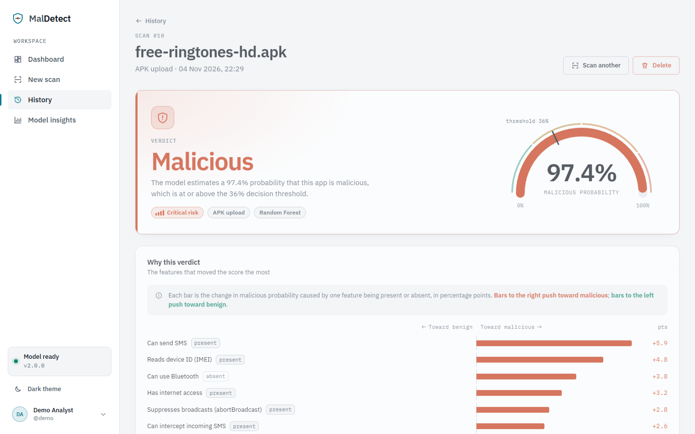
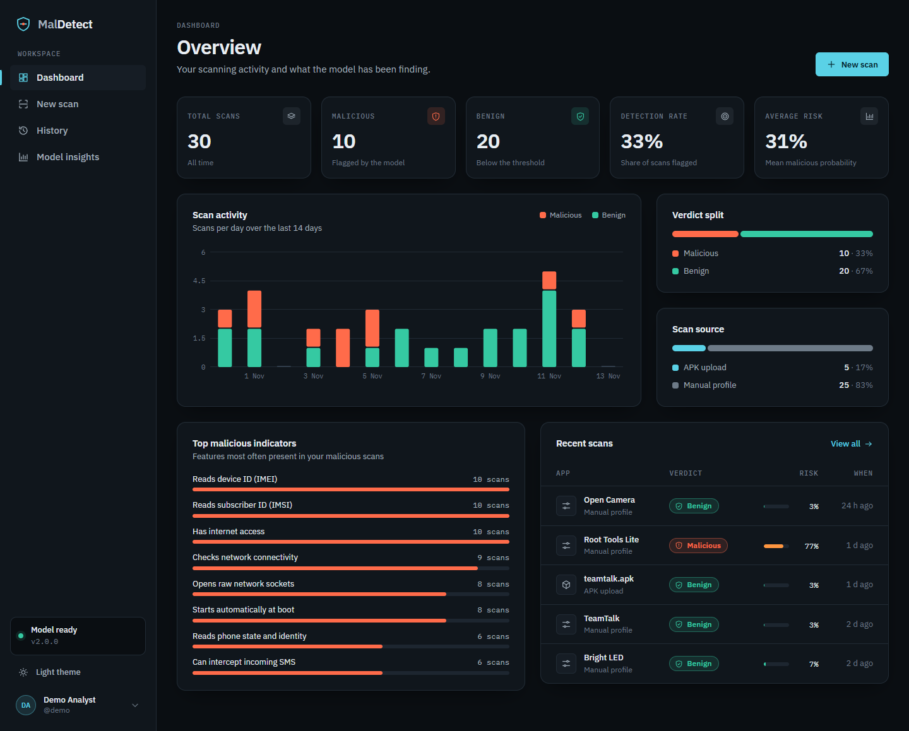

</div>

---

## Overview

MalDetect classifies an Android application as **malicious** or **benign** from 35 static
indicators — requested permissions, sensitive API calls, broadcast intents, shell commands and
embedded file references. You can upload a real `.apk` and let the built-in static analyser extract
those indicators, or describe an app by hand. Every verdict comes with a calibrated probability and
a per-feature explanation of *why* the model decided what it did.

The project is a full rewrite of an earlier tkinter prototype. The rewrite fixed a serious
evaluation flaw (see [the data-leakage story](#the-data-leakage-story)), replaced plaintext
password storage, and turned a set of scripts into a tested web application.

## ✨ Features

| | |
|---|---|
| 📦 **APK static analysis** | Dependency-free parser for the binary `AndroidManifest.xml` and `classes*.dex` string/method tables. Nothing is extracted to disk or executed; zip-bomb and malformed-input guards included. |
| 🧠 **Honest ML pipeline** | Seven model families compared with stratified 5-fold CV, probability calibration, and an F2-tuned decision threshold — all on de-duplicated data. |
| 🔍 **Explainable verdicts** | Model-agnostic contribution scores show how much each feature pushed the probability toward malicious or benign. |
| 📊 **Analyst dashboard** | Scan activity, verdict split, top malicious indicators, searchable history and a full model-insights page. |
| 🔐 **Secure by default** | scrypt password hashing, hashed server-side session tokens, login rate limiting, strict CSP and security headers, per-user data isolation. |
| 🎨 **Polished UI** | Zero-build single-page app: dark and light themes, hand-written SVG charts, responsive down to phone width, keyboard accessible. |
| ✅ **Tested** | 162 automated tests (ML pipeline, APK parser, REST API), `ruff` lint, GitHub Actions CI, Dockerfile. |

## 📸 Screenshots

<table>
  <tr>
    <td width="50%">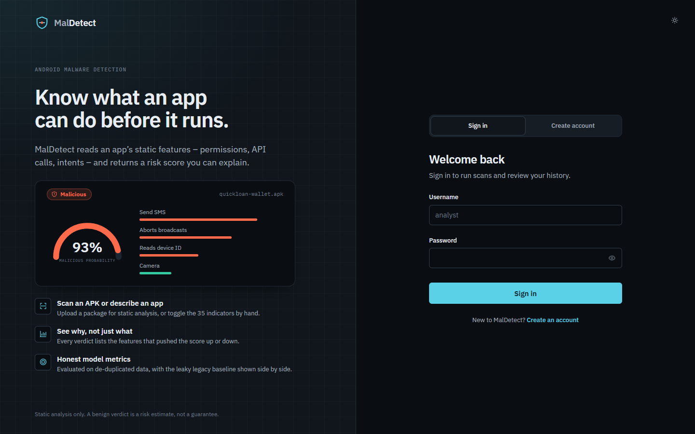<p align="center"><sub><b>Sign in</b></sub></p></td>
    <td width="50%"><p align="center"><sub><b>Dashboard</b> — activity, verdict split, top indicators</sub></p></td>
  </tr>
  <tr>
    <td>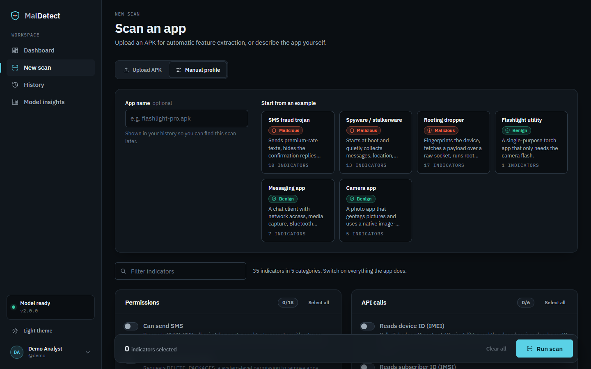<p align="center"><sub><b>New scan</b> — presets and 35 grouped indicator toggles</sub></p></td>
    <td>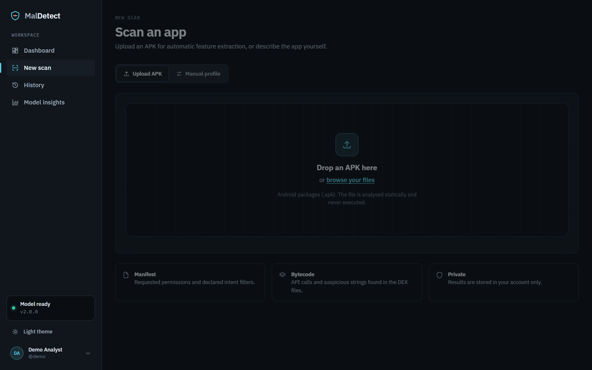<p align="center"><sub><b>APK upload</b> — automatic feature extraction</sub></p></td>
  </tr>
  <tr>
    <td>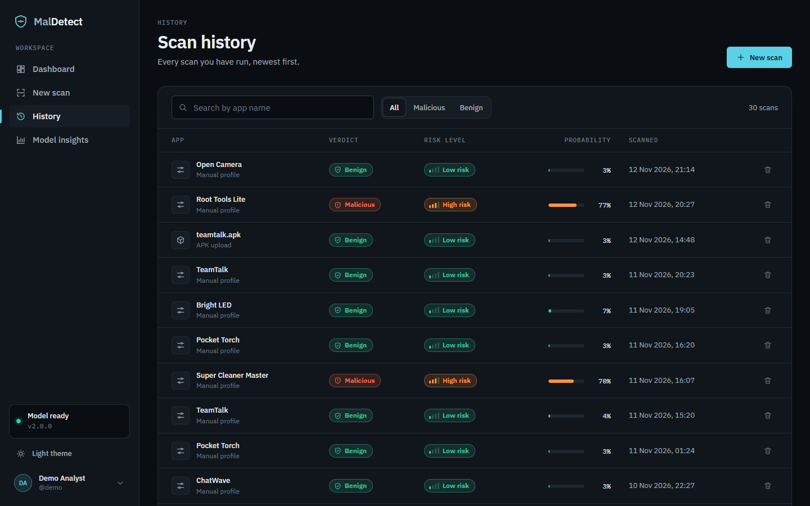<p align="center"><sub><b>History</b> — search, filter, paginate</sub></p></td>
    <td>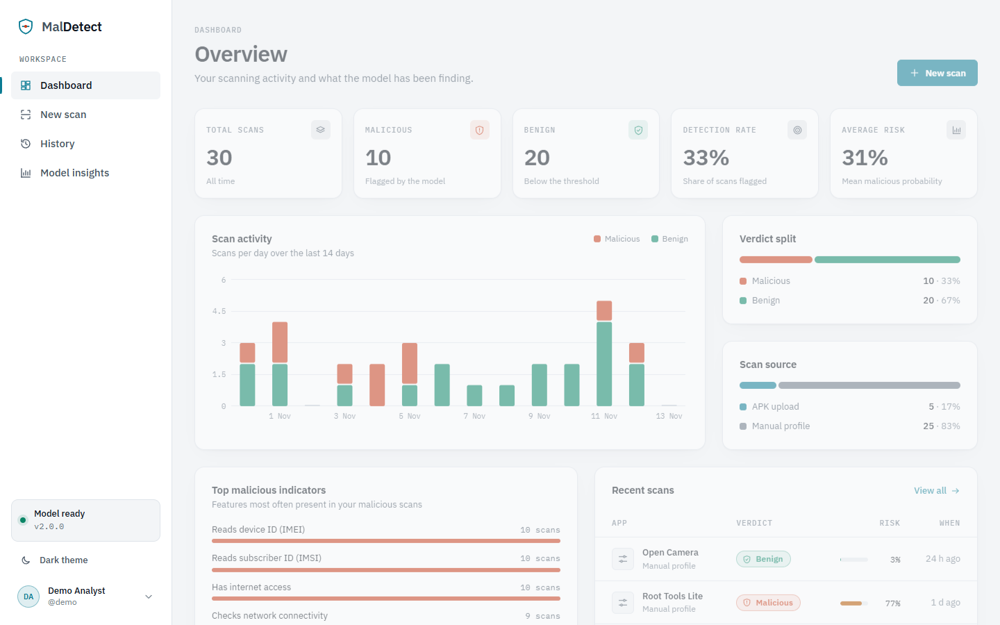<p align="center"><sub><b>Light theme</b></sub></p></td>
  </tr>
</table>

<details>
<summary><b>Scan result — verdict, risk gauge, explanation, APK evidence</b> (full page)</summary>
<br />
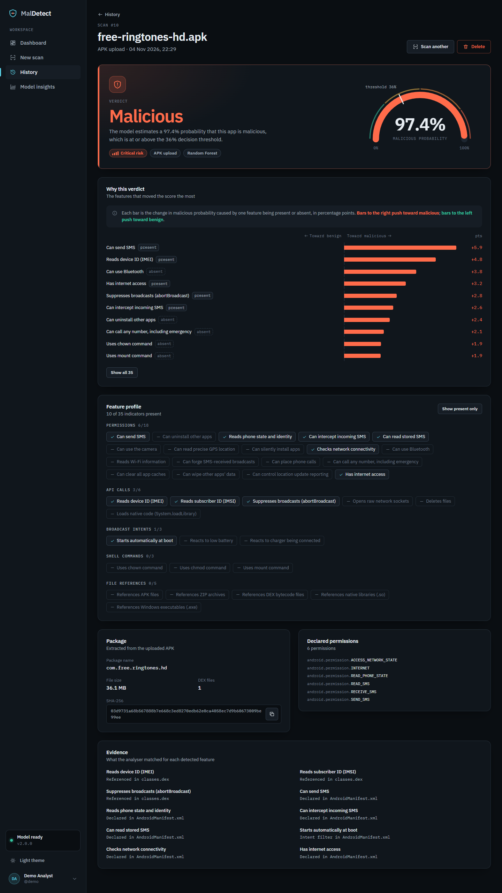
</details>

<details>
<summary><b>Model insights — metrics, model comparison, curves, feature importance</b> (full page)</summary>
<br />
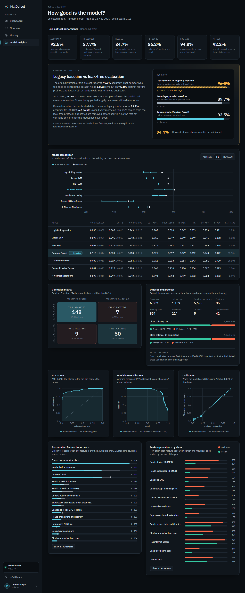
</details>

<details>
<summary><b>Mobile layout</b></summary>
<br />
<p align="center">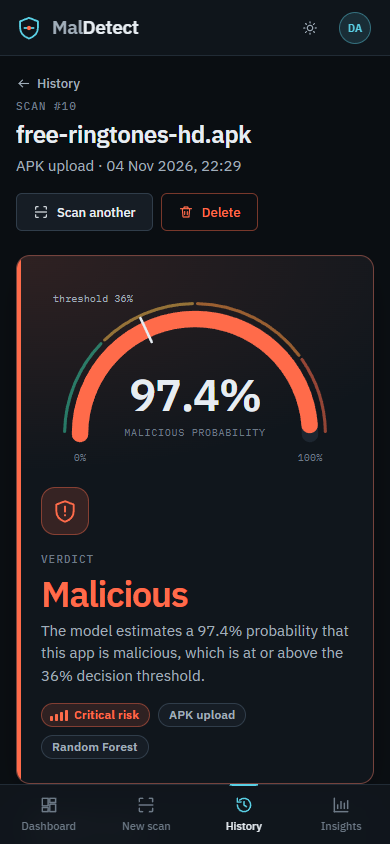</p>
</details>

## 📈 Model & metrics

All numbers below are measured on a **held-out test set of 214 apps the model never saw**, after
removing duplicate rows. They are regenerated by `python -m maldetect.ml.train` and stored in
[`models/metrics.json`](models/metrics.json).

<div align="center">

| Accuracy | Precision | Recall | F1 | ROC AUC | PR AUC |
|:---:|:---:|:---:|:---:|:---:|:---:|
| **92.5%** | **87.7%** | **84.7%** | **86.2%** | **0.948** | **0.922** |

</div>

Selected model: **Random Forest** (200 trees, sigmoid-calibrated), decision threshold **0.36**.

| Confusion matrix (test) | Predicted benign | Predicted malicious |
|---|:---:|:---:|
| **Actually benign** | 148 | 7 |
| **Actually malicious** | 9 | 50 |

### Model comparison

Each candidate is cross-validated on the training portion only; the winner is chosen by mean CV
ROC AUC, so the test set plays no part in model selection.

| Model | CV ROC AUC | CV F1 | Test accuracy | Test precision | Test recall | Test F1 | Test ROC AUC |
|---|:---:|:---:|:---:|:---:|:---:|:---:|:---:|
| Logistic Regression | 0.943 | 0.805 | 0.907 | 0.820 | 0.847 | 0.833 | 0.953 |
| Linear SVM | 0.942 | 0.796 | 0.916 | 0.847 | 0.847 | 0.847 | 0.945 |
| RBF SVM | 0.953 | 0.825 | 0.916 | 0.847 | 0.847 | 0.847 | 0.949 |
| **Random Forest** ✓ | **0.958** | **0.839** | **0.925** | **0.877** | 0.847 | **0.862** | 0.948 |
| Gradient Boosting | 0.954 | 0.827 | 0.911 | 0.823 | **0.864** | 0.843 | **0.961** |
| Bernoulli Naive Bayes | 0.908 | 0.728 | 0.860 | 0.730 | 0.780 | 0.754 | 0.897 |
| k-Nearest Neighbors | 0.942 | 0.777 | 0.893 | 0.810 | 0.797 | 0.803 | 0.928 |

<p align="center">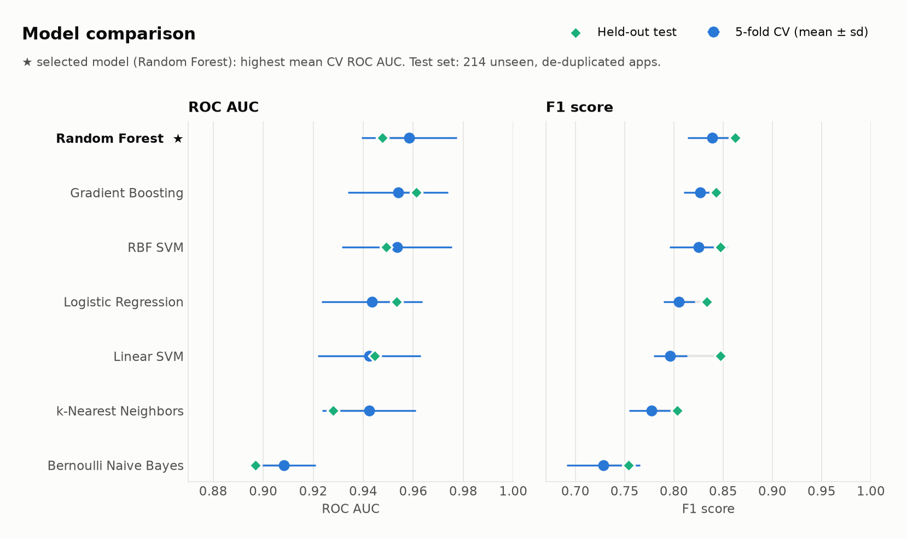</p>

<table>
  <tr>
    <td width="50%">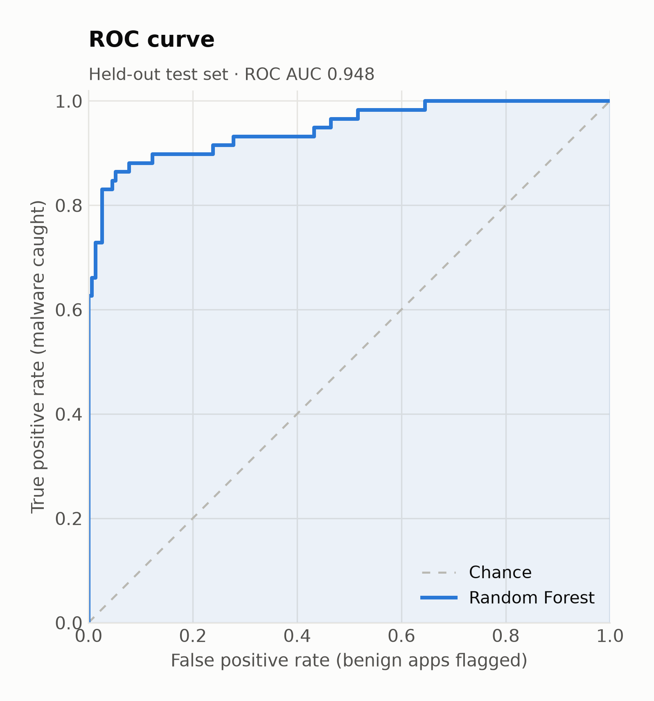</td>
    <td width="50%">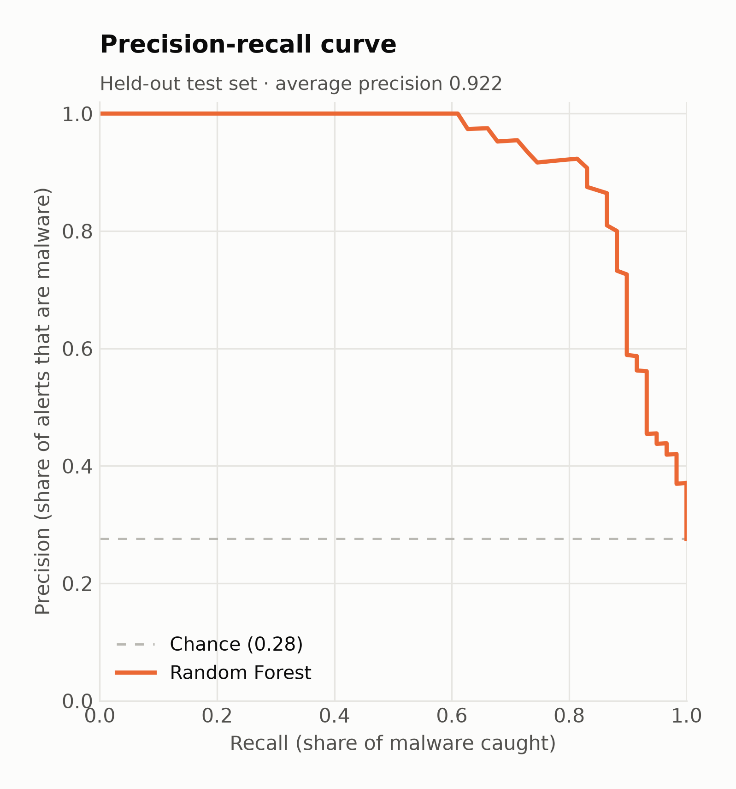</td>
  </tr>
  <tr>
    <td>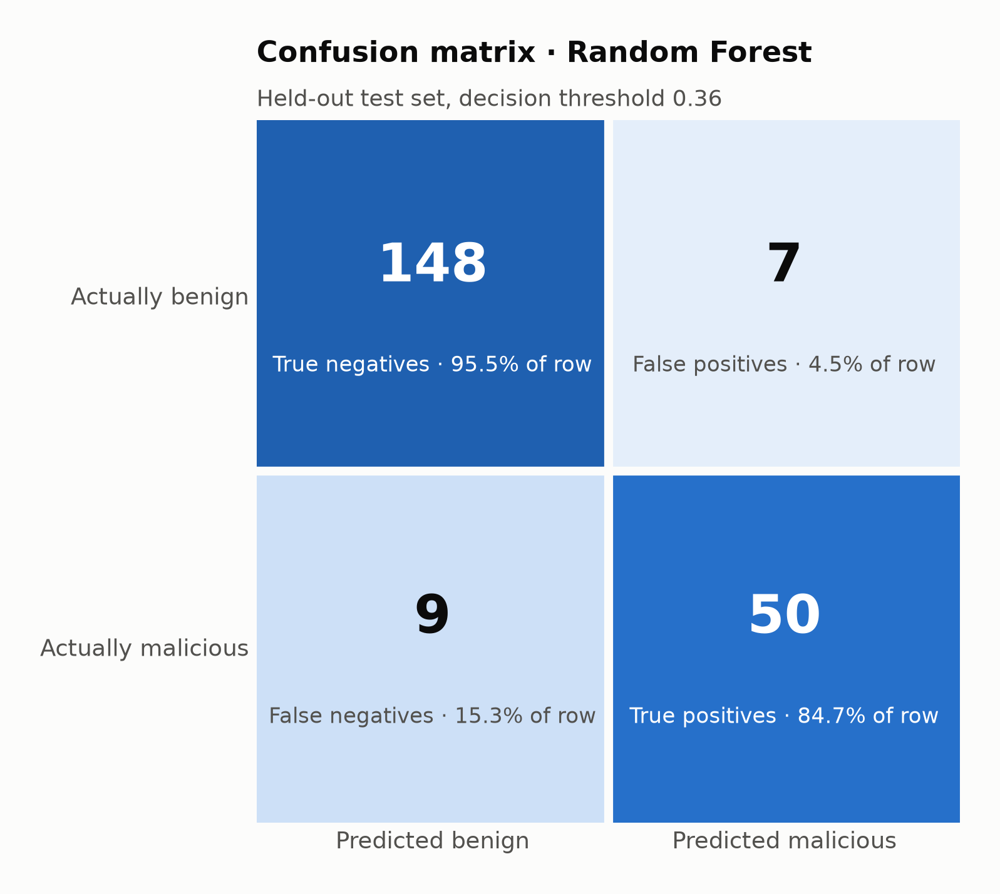</td>
    <td>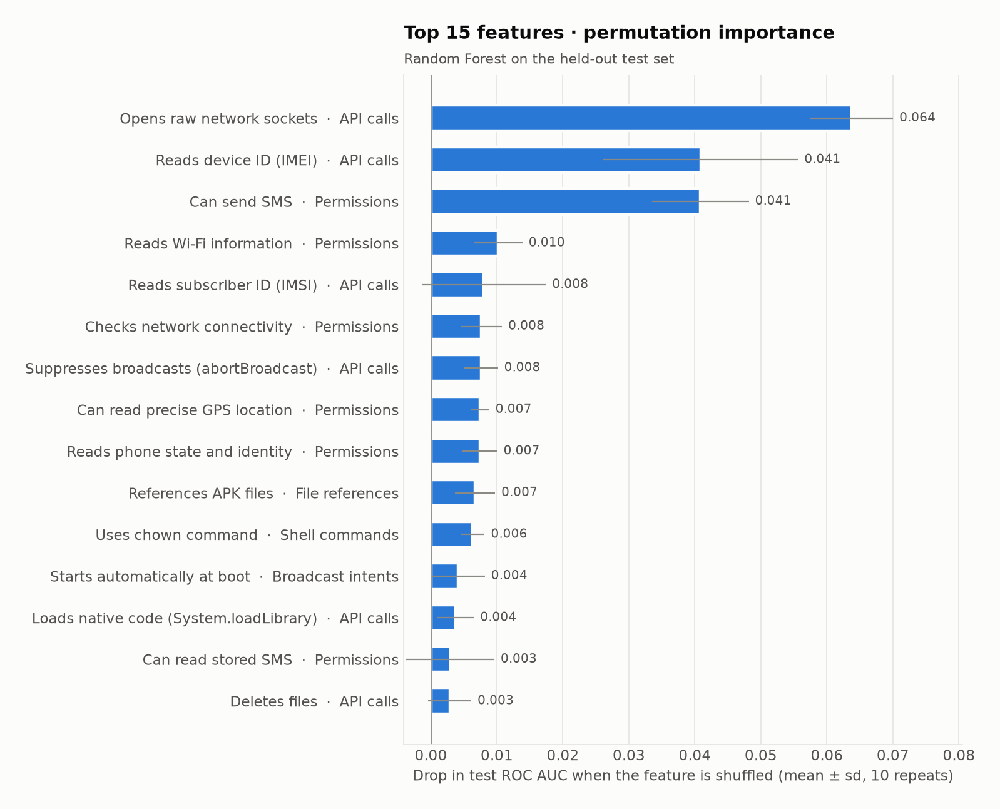</td>
  </tr>
</table>

The strongest signals (permutation importance) are raw network sockets, reading the device ID
(IMEI) and the ability to send SMS — consistent with SMS-fraud and data-exfiltration malware.

### The data-leakage story

The original prototype reported **96.0% accuracy**. That number was not real.

- The dataset has **6,802 rows but only 1,107 are unique** — 84% are exact duplicates.
- The prototype split the raw rows at random, so **94.4% of its test rows were identical to rows
  it had trained on**. It was largely being graded on answers it had memorised.
- Re-evaluating that same model (linear SVM, 25 hand-picked features) on a de-duplicated split
  gives **89.7% accuracy, F1 0.800**.
- 36 feature vectors also appeared with *both* labels; these are resolved by majority vote
  (33) or dropped when tied (3), leaving 1,068 rows for modelling.

<p align="center">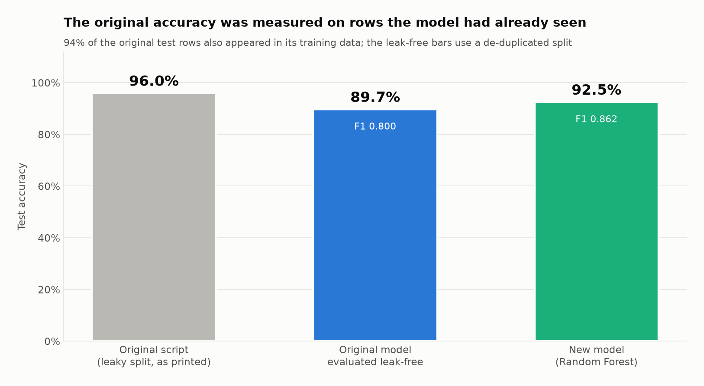</p>

| | Accuracy | F1 | Recall |
|---|:---:|:---:|:---:|
| Original script, as printed (leaky) | ~~96.0%~~ | – | – |
| Original model, leak-free | 89.7% | 0.800 | 0.746 |
| **MalDetect (Random Forest)** | **92.5%** | **0.862** | **0.847** |

So the honest headline is lower than the old one — and the new model is genuinely better:
**+2.8 points accuracy, +6.2 points F1 and +10 points recall** on the same fair test.

### What changed from the prototype

| Area | Before | After |
|---|---|---|
| Evaluation | Random split on duplicated data, accuracy only | De-duplicated, stratified split, 5-fold CV, 6 metrics, calibration |
| Model | One unseeded linear SVM, label only | 7 families compared, calibrated probabilities, tuned threshold, reproducible |
| Features | 10 columns dropped by hand, 75 copy-pasted encoding lines | All 35 features, described in one typed catalog |
| Input | Type `0`/`1` into 25 text boxes | Upload an APK, or use toggles and presets |
| Output | A red or green label | Probability, risk level, per-feature explanation, APK evidence |
| Passwords | Stored in plaintext in a committed database | scrypt hashes, hashed session tokens, rate limiting |
| App | tkinter windows launching each other via `subprocess`, hardcoded `E:/` paths | FastAPI service + responsive web app, config-driven paths |
| Quality | No tests | 162 tests, lint, CI, Docker |

## 🚀 Quick start

Requires Python 3.10+.

```bash
git clone https://github.com/musaddiq-vd/malicious-application-detection.git
cd malicious-application-detection

python -m venv .venv
# Windows: .venv\Scripts\activate      macOS/Linux: source .venv/bin/activate
pip install -r requirements.txt

python -m maldetect
```

Open <http://127.0.0.1:8000> and create an account. A trained model ships in `models/`, so scans
work immediately.

**Optional — load demo data** (a `demo` user with 30 sample scans; password `demo-pass-2026`
unless `MALDETECT_DEMO_PASSWORD` is set — for local use only):

```bash
python scripts/seed_demo.py
```

**Retrain the model and regenerate metrics and figures** (about 2–3 minutes):

```bash
python -m maldetect.ml.train
```

**Run the tests and linter:**

```bash
pip install -r requirements-dev.txt
pytest
ruff check .
```

**Docker:**

```bash
docker build -t maldetect .
docker run -p 8000:8000 -v maldetect-data:/data maldetect
```

### Configuration

| Variable | Default | Purpose |
|---|---|---|
| `MALDETECT_HOST` / `MALDETECT_PORT` | `127.0.0.1` / `8000` | Bind address |
| `MALDETECT_DB` | `instance/maldetect.db` | SQLite database path |
| `MALDETECT_MAX_UPLOAD_MB` | `100` | Largest accepted APK |
| `MALDETECT_COOKIE_SECURE` | `0` | Set to `1` behind HTTPS |

## 🔌 REST API

Interactive documentation is served at `/api/docs`. All endpoints except health, register and
login require a session cookie.

| Method | Endpoint | Description |
|---|---|---|
| `GET` | `/api/health` | Service and model status |
| `POST` | `/api/auth/register` · `/login` · `/logout` | Account and session management |
| `GET` | `/api/auth/me` | Current user |
| `GET` | `/api/features` · `/api/features/presets` | Feature catalog and example profiles |
| `POST` | `/api/scans/manual` | Score a hand-described feature profile |
| `POST` | `/api/scans/apk` | Upload an APK for static analysis and scoring |
| `GET` | `/api/scans` | Scan history (`limit`, `offset`, `verdict`, `q`) |
| `GET` / `DELETE` | `/api/scans/{id}` | Fetch or delete one scan |
| `GET` | `/api/stats` | Dashboard aggregates |
| `GET` | `/api/model/metrics` | Full training and evaluation report |

```jsonc
// POST /api/scans/manual
{ "app_name": "free-ringtones", "features": { "send_sms": 1, "receive_sms": 1, "internet": 1 } }

// 201 Created (abridged)
{
  "id": 31, "verdict": "malicious", "probability": 0.91, "risk_level": "critical",
  "threshold": 0.36, "model_name": "Random Forest",
  "contributions": [ { "slug": "send_sms", "label": "Can send SMS", "value": 1, "impact": 0.059 } ]
}
```

## 🏗 Architecture

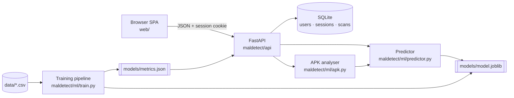

```
maldetect/
├── config.py            paths and environment-driven settings
├── features.py          typed catalog of the 35 features
├── ml/
│   ├── data.py          loading, validation, de-duplication, stratified split
│   ├── train.py         model comparison, calibration, threshold tuning, export
│   ├── explain.py       model-agnostic per-feature contributions
│   ├── predictor.py     the single inference entry point
│   ├── apk.py           dependency-free static APK analysis
│   └── figures.py       report charts
└── api/                 FastAPI app, routers, auth, storage, middleware
web/                     static single-page app (HTML, CSS, ES modules — no build step)
data/                    training dataset
models/                  trained model and metrics report
reports/figures/         generated evaluation charts
scripts/seed_demo.py     demo account and sample scans
tests/                   pytest suite
```

### How a verdict is explained

For each of the 35 features the predictor asks: *what would the malicious probability be if only
this feature were flipped?* The difference is that feature's contribution. It is model-agnostic,
cheap (one batched `predict_proba` call) and easy to read: positive values pushed the app toward
malicious, negative toward benign.

## ⚠️ Limitations

- **Static analysis only.** Nothing is executed; obfuscated, packed or dynamically loaded code can
  hide behaviour from the analyser.
- **Approximate API-call detection.** Features such as `TelephonyManager.getDeviceId` are matched
  against DEX method references rather than decompiled code. The APK parser is covered by tests
  built on synthetic APKs and has not been benchmarked on a large real-world corpus.
- **Small dataset.** After de-duplication there are 1,068 labelled apps, so metrics carry a few
  points of uncertainty (CV standard deviations are shown on the insights page).
- **A benign verdict is a risk estimate, not a guarantee.** Use it for triage and education, not
  as a replacement for a production antivirus.

## 👤 Author

**Musaddiq** — [@musaddiq-vd](https://github.com/musaddiq-vd)
